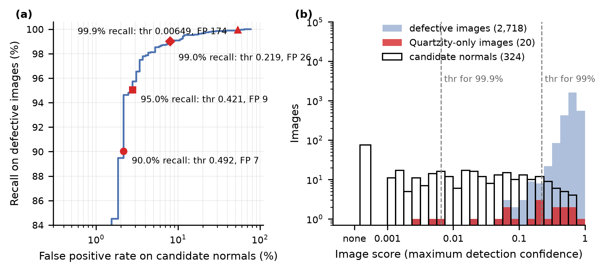
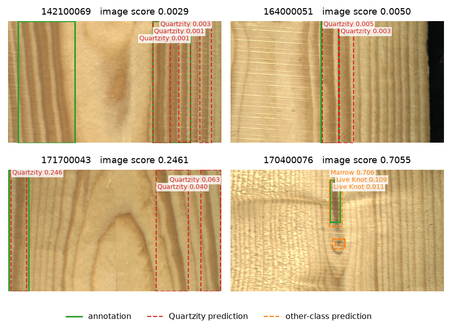
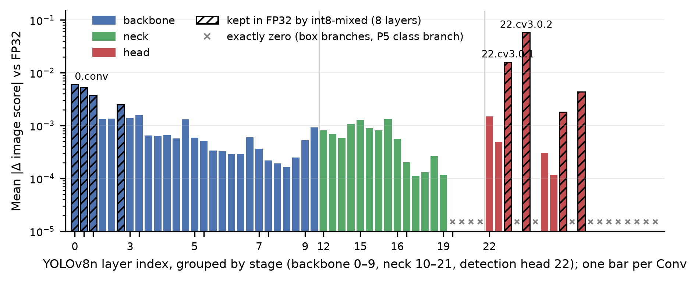

# Woode

**Board-level wood defect screening: a YOLOv8n detector taken from training to an audited operating point
and an INT8 CPU model.**

Woode comes from an inspection-line requirement met during an internship: reject every board that carries a
defect, with a recall target of 99.9%, and pay as few false alarms as possible. It is built on the VSB wood
surface defect dataset [1].

**Key findings**

- **99% recall costs 8% false alarms, 99.9% costs 54%.** The gap is a handful of *Quartzity* boards whose
  annotation is ambiguous.
- **A 99.9% recall target cannot be verified on 2,718 defective images.** It allows two misses, so one image
  sets the threshold; the Wilson 95% interval is 99.7–99.98%.
- **INT8 is 3.6× smaller and 2.6× faster on an Apple M5** (1.45× on a Xeon without VNNI), with recall within
  0.3 points at the same threshold.
- **One layer carries the INT8 score drift.** Keeping 8 of 64 convolutions in FP32 cuts the drift four-fold
  for 7% more size.

## Contents

- [1. Problem and setup](#1-problem-and-setup)
- [2. Training](#2-training)
- [3. Operating points](#3-operating-points)
- [4. What did not help](#4-what-did-not-help)
- [5. Why the model misses](#5-why-the-model-misses)
- [6. Quantization](#6-quantization)
- [7. Reproduce](#7-reproduce)
- [8. Repository](#8-repository)
- [References](#references)
- [License](#license)

## 1. Problem and setup

| | |
|---|---|
| **Decision** | A board is rejected when its highest detection confidence reaches a threshold. |
| **Metric** | Recall on defective images and false positive rate (FPR) on images without annotation, called *candidate normals*. The threshold is picked on validation for a target recall. |
| **Data** | VSB [1]: 20,275 line-scan images of 2,800 × 1,024 px, ten defect classes, 43,974 boxes, CC BY 4.0. Train / val / test = 14,196 / 3,042 / 3,038, split by board sequence. Validation holds 2,718 defective images and 324 candidate normals. |
| **Model** | YOLOv8n, 3.0 M parameters, Ultralytics 8.4.115 [2]. Letterboxing keeps the 2.73:1 aspect ratio, so the network input is 256 × 640. |

Box mAP is tracked during training; the operating point is what the line needs.

## 2. Training

Two runs with one recipe ([`configs/`](configs/)): 100 epochs, batch 16 on two NVIDIA TITAN RTX GPUs (DDP),
mixed precision, input 640, about six hours each.

| Run | Optimizer | Best epoch | Precision | Recall | mAP50 | mAP50-95 |
|---|---|---:|---:|---:|---:|---:|
| MuSGD | MuSGD, lr 0.01, momentum 0.9 | 45 / 100 | 0.626 | 0.662 | 0.670 | **0.404** |
| AdamW | AdamW, lr 7.1e-4 | 52 / 100 | 0.636 | 0.629 | 0.655 | 0.395 |

The gap is within single-seed noise, so the MuSGD checkpoint is used from here on. [`train.py`](train.py)
writes a receipt of the requested and the effective settings and stops if the backend changes them silently
(batch halving after an out-of-memory error, optimizer substitution, dropped samples).

## 3. Operating points



*Figure 1. (a) Recall against false positive rate on validation, with the operating points for four recall
targets. (b) Distribution of the image score; "none" counts images without any detection. Quartzity-only
images (red) sit in the low-score tail.*

| Recall target | Threshold | Recall | Misses | False positives | FPR |
|---:|---:|---:|---:|---:|---:|
| 90% | 0.492 | 90.03% | 271 | 7 | 2.2% |
| 95% | 0.421 | 95.03% | 135 | 9 | 2.8% |
| 99% | 0.219 | 99.01% | 27 | 26 | 8.0% |
| 99.9% | 0.0065 | 99.93% | 2 | 174 | 53.7% |

Recall is cheap up to 99% and expensive after it: the last 25 defective boards cost 148 more false alarms.
Figure 1(b) shows why. Defective images score above 0.3 with a thin tail down to 0.003, while candidate
normals are spread over four decades of score, so a threshold low enough for the tail lets most of them
through.

## 4. What did not help

| Experiment | mAP50-95 | FP at 99% recall | 99.9% recall |
|---|---:|---:|---|
| First round (640 square letterbox) | 0.404 | 25 | 2 misses |
| Fine-tune 20 epochs, control (lr 1e-3, no mosaic) | 0.381 | 25 | out of reach |
| Fine-tune 20 epochs with a hard-normal penalty | 0.382 | 26 | out of reach |
| Inference at 1,280 with the 640-trained weights | — | 54 | 2 misses, FP 271 |

Fine-tuning lowered box mAP and pushed three Quartzity images to a score of zero, which put 99.9% out of
reach. The hard-normal penalty ([`loss.py`](loss.py): top-10 softplus on the class logits of empty-label
images) changed one false positive against its control. Doubling the input resolution was worse everywhere,
so the misses are not small objects. Both experiments pointed at the data.

## 5. Why the model misses

Every image missed or barely caught at 99.9% recall is a board whose only defect class is *Quartzity*.



*Figure 2. Validation images (VSB, CC BY 4.0; 1,800 of 2,800 pixels shown) with the annotation in green and
the three strongest predictions dashed. Top: the two images missed at the 99.9% threshold. Bottom left: an
annotated band next to two similar bands without annotation. Bottom right: a spot labelled Quartzity that
the model calls Marrow at 0.71.*

- **The class is ambiguous.** Quartzity is annotated as narrow full-height bands of dark grain. Most boards
  carry several similar bands and only one or two are annotated.
- **The model finds the bands but is not confident.** Predictions overlap the annotations at confidence
  0.001–0.08, so this is a confidence problem, not a localization or resolution problem.
- **Some labels look wrong.** Short dark spots labelled Quartzity are classified as Marrow or Live_Knot at
  0.36–0.71.

A 99.9% target allows two misses among 2,718 defective images, so the threshold is the third-lowest score:
one image. Running the same model in ONNX Runtime on a CPU already moves a board across it. The operating
point to ship is 99% recall (95% interval 98.6–99.3%); 99.9% needs about ten times more boards and a
Quartzity relabelling pass. A separate threshold for the Quartzity channel would halve the false alarms at
the 99.9% point, from 174 to 87, estimated from the per-class scores in
[`results/validation/scores.csv`](results/validation/scores.csv).

## 6. Quantization

[`quantize.py`](quantize.py) exports the checkpoint to a static ONNX graph with input 1 × 3 × 256 × 640 and
builds the variants below. Each one is scored through the same letterbox, decoding and NMS as the PyTorch
model. Only the 64 convolutions are quantized; the box decoding stays in floating point. Static variants use
QDQ, uint8 activations and int8 per-channel weights, calibrated on 300 training images.

| Variant | Method | Size | Apple M5, 1 thread | Apple M5, 4 threads | Xeon Silver 4110, 1 thread | Xeon, 4 threads |
|---|---|---:|---:|---:|---:|---:|
| fp32 | Ultralytics export | 12.14 MB | 34.9 ms | 11.8 ms | 82.1 ms | 36.9 ms |
| fp16 | half-precision weights | 6.11 MB | 35.7 ms | 12.8 ms | 85.1 ms | 33.8 ms |
| int8-dynamic | weights offline, activations per run | 3.25 MB | 15.6 ms | 8.7 ms | 72.4 ms | 47.2 ms |
| int8-minmax | static, MinMax calibration | 3.35 MB | 13.4 ms | 6.3 ms | 56.6 ms | 29.5 ms |
| int8-percentile | static, 99.999th percentile | 3.35 MB | 13.6 ms | 6.5 ms | 56.6 ms | 27.4 ms |
| int8-mixed | percentile, 8 sensitive layers in FP32 | 3.58 MB | 15.7 ms | 6.5 ms | TBD | TBD |

Latency is the model forward pass in ONNX Runtime 1.23.2 on the CPU, batch 1, median of 200 runs. FP16 halves
the file and nothing else. The INT8 speed-up is set by the instruction set: the Xeon has no VNNI and needs
three instructions per 8-bit dot product, while the M5 has `SDOT/UDOT`.

The table below applies the FP32 thresholds unchanged to every variant. "Flips" counts images whose
accept/reject decision differs from FP32.

| Variant | 99% point: recall / misses / FP / flips | 99.9% point: recall / misses / FP / flips | Mean \|Δ score\| | Images with \|Δ\| > 0.05 |
|---|---|---|---:|---:|
| FP32 PyTorch (GPU) | 99.01% / 27 / 26 / — | 99.93% / 2 / 174 / — | — | — |
| fp32 ONNX (CPU) | 99.01% / 27 / 26 / 0 | 99.89% / 3 / 174 / 1 | 0.0000 | 0 |
| fp16 | 98.97% / 28 / 26 / 1 | 99.93% / 2 / 174 / 0 | 0.0002 | 0 |
| int8-dynamic | 98.71% / 35 / 25 / 13 | 99.93% / 2 / 171 / 21 | 0.023 | 333 |
| int8-minmax | 99.15% / 23 / 30 / 22 | 99.85% / 4 / 174 / 30 | 0.064 | 1,659 |
| int8-percentile | 98.75% / 34 / 24 / 19 | 99.85% / 4 / 172 / 28 | 0.025 | 388 |
| int8-mixed | 99.04% / 26 / 24 / 5 | 99.89% / 3 / 174 / 7 | 0.006 | 10 |

8-bit post-training quantization costs at most 0.3 points of recall at the 99% point and two boards at
99.9%, the same order as the CPU-versus-GPU rounding difference. If each variant picks its own thresholds,
recall holds and the cost moves to false positives: 24–31 at 99% against 26 for FP32.

**Where the drift comes from.** [`sensitivity.py`](sensitivity.py) quantizes one convolution at a time and
measures the mean change of the image score on 200 training images that were not used for calibration.



*Figure 3. INT8 sensitivity of the 64 convolutions, grouped by stage. Hatched bars are the eight layers that
int8-mixed keeps in FP32. Fifteen layers have zero effect: the box-regression branches, which never enter
the image score, and the P5 classification branch.*

The last convolution of the P3 classification head alone shifts the score by 0.058, as much as quantizing
the whole network with MinMax. It shifts the score upwards, which is why int8-minmax has fewer misses and
more false positives than FP32. The next layers are the convolution before it and the first two backbone
convolutions, the first-layer and classifier-output sensitivity described in [3, 4].

`int8-mixed` keeps these eight layers in FP32. The mean drift on validation falls from 0.025 to 0.006 and
the decision flips at the 99% threshold from 19 to 5, for 7% more size and 15% more single-thread latency.
Recall and FPR barely move because 8-bit was already close to lossless; what mixed precision buys is
agreement with the FP32 decision.

Entropy calibration is left out: through ONNX Runtime's `quantize_static` it runs with 128 histogram bins
and is identical to MinMax. 4-bit weights have no CPU convolution kernel in ONNX Runtime.

## 7. Reproduce

Python 3.11+ with [`requirements.txt`](requirements.txt). Set `[paths]` in the config, then:

```bash
python data.py configs/vsb-musgd.toml                                   # prepare the splits
torchrun --nproc_per_node 2 train.py configs/vsb-musgd.toml             # or: python train.py configs/vsb-musgd.toml --device 0
python evaluate.py --config configs/vsb-eval-640-rect.toml --weights runs/vsb-musgd-v2/weights/best.pt --output runs/eval-fp32 --device 0
python quantize.py --config configs/vsb-quantize.toml --weights runs/vsb-musgd-v2/weights/best.pt --output runs/quantized
python evaluate.py --config configs/vsb-quantize.toml --weights runs/quantized/int8-percentile.onnx --output runs/eval-int8-percentile --device cpu
python sensitivity.py --config configs/vsb-quantize.toml --quantized runs/quantized --output runs/sensitivity
python quantize.py --compare runs/eval-fp32 runs/eval-int8-percentile --output runs/comparison.json
python quantize.py --benchmark runs/quantized                           # time the variants on another machine
python figures.py --prepared splits --weights runs/vsb-musgd-v2/weights/best.pt
```

Every script writes a JSON receipt with the hashes of its inputs next to its results. `evaluate.py --split
test --calibration <val-run>/threshold-lock/calibration.json` applies a threshold frozen on validation to
the test split.

## 8. Repository

```text
config.py          TOML recipe reader and validation
data.py            split preparation, class names, label reader
model.py           load a .pt checkpoint or an .onnx graph, score one image
train.py           training with receipts of requested and effective settings
loss.py            hard-normal penalty used in Section 4
evaluate.py        image-level metric and threshold selection
quantize.py        ONNX export, fp16 and INT8 variants, size, latency, comparison
sensitivity.py     per-layer INT8 sensitivity and the mixed-precision variant
figures.py         renders figures/ from results/
configs/           one TOML per experiment
results/           receipts behind every number above
figures/           the three figures
```

## References

1. P. Kodytek, A. Bodzas, P. Bilik. A large-scale image dataset of wood surface defects for automated
   vision-based quality control processes. *F1000Research* 10:581, version 2, 2022.
   doi:10.12688/f1000research.52903.2. Data: doi:10.5281/zenodo.4694695.
2. G. Jocher, J. Qiu, A. Chaurasia. Ultralytics YOLO, version 8.0.0, 2023.
   https://github.com/ultralytics/ultralytics
3. R. Krishnamoorthi. Quantizing deep convolutional networks for efficient inference: a whitepaper.
   arXiv:1806.08342, 2018.
4. M. Nagel, M. Fournarakis, R. A. Amjad, Y. Bondarenko, M. van Baalen, T. Blankevoort. A white paper on
   neural network quantization. arXiv:2106.08295, 2021.
5. B. Jacob et al. Quantization and training of neural networks for efficient integer-arithmetic-only
   inference. *CVPR*, 2018.
6. ONNX Runtime developers. ONNX Runtime, 2021. https://onnxruntime.ai

## License

Code is released under the [MIT License](LICENSE). Figure 2 reproduces images from the VSB dataset
(CC BY 4.0), and the Ultralytics backend is licensed separately under AGPL-3.0.
